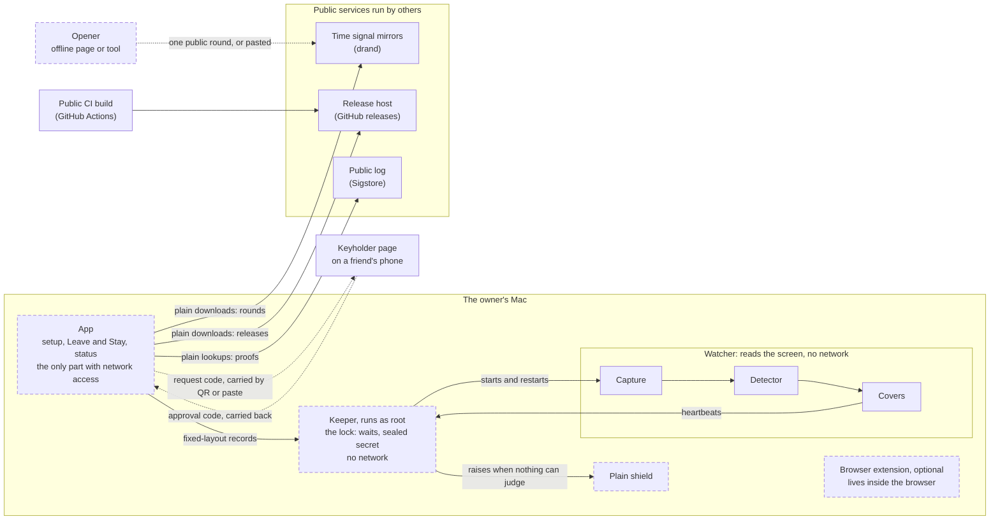

<!-- SPDX-License-Identifier: Apache-2.0 -->
# How SafeSight Mac is built

This is the map of the project for an engineering team picking it up. It takes about fifteen minutes to read. It describes the design as a whole, says which parts exist today and which are still plans, and points to where each decision is written down.

SafeSight Mac does two things. It **covers explicit images on the screen**, in any app and on every display, by looking at what the Mac draws. And it can **lock itself in place**, so that turning it off takes a waiting period the owner chose ahead of time. The second part is what makes it different: nobody holds a lever that ends the wait early, not a server, not a support desk, and not the people who wrote the code. The Mac enforces the wait itself, counted against a public time signal.

## The picture



Dashed boxes are not finished yet. The keeper's core logic is built and tested on CI, but only on the `keeper-core` branch (see "The keeper"), and it does not run on a Mac yet; the opener is on an open pull request; the app with network access, the plain shield and the browser extension are designs. What `main` builds today is the watcher alone, inside one menu-bar app with no networking code at all, in two editions: the cover-only preview and the Testing edition for helpers.

## The parts

### The watcher: capture, detector and covers

The watcher is the part that protects. It runs as the owner, holds the Screen Recording permission, and has no network access.

- **Capture** (`Sources/SafeSightMacCapture`) runs one ScreenCaptureKit stream per display at full pixel size, with no cursor and no audio, and leaves the app's own windows out. It works out which areas changed so only those are judged, and judges the whole screen again every 30 seconds.
- **The detector** (`Sources/Preprocess`, `Sources/RegionFinder`, `Sources/DetectorCore`) decides what to cover. A cheap picture finder picks out picture regions so text and interface never reach the models. Two model families then judge each picture, and a third model breaks ties. The detector's only output is a class for each picture: clear, blur, or cover. Which models run, and in which role, is set by a manifest beside them, not by the code. Model files are never in git; they load from a local folder and every file, the manifest included, is checked against a hash list sealed into the build (`models/`). A maintainer can bring their own model by the contract in `spec/detector-contract.md`. The preprocessing is pinned by a written spec with bit-exact test vectors (`spec/`).
- **The cover layer** (`Sources/SafeSightMacWatcher`) is pure logic with no screen access: it splits changes by window, budgets the judging, plans covers, lifts a cover only after four clean judgements in a row, moves covers with scrolled content, and turns every fault into more covering.
- **Covers** (`Sources/SafeSightMacCover`) are the drawing: one click-through panel per display, opaque calm covers, a short way-out line ("Press ⌘W to close this tab, or ⌘[ to go back.") on large covers, and a repair card that says in plain words why a display is covered. Covers never take the keyboard, so shortcuts reach the app underneath.

**Two narrow exceptions.** The window server's own small overlays at the cursor's level (the pointer, the screen-recording indicator) never count as another app's window above the covers. And **macOS's password prompt is left uncovered**, so the owner can always type their password: it sits at level 1000, under the covers (1990), so without this a covered screen hid it until it was judged. Both are told apart only by facts an app can't set for itself, never by a name (`Sources/SafeSightMacWatcher/PasswordPrompt.swift`, `Windows.swift`, `Sources/SafeSightMacCapture/WindowList.swift`):

- *Which window.* The window's owning process, read from the kernel by process identifier (`proc_pidpath`, its user and start time from the process table), must run an executable that lies on the sealed, read-only system volume macOS booted from (`statfs`), inside a bundle whose Info.plist, on that same volume, says it is Apple's SecurityAgent or its helper, and it must run as the owner's own user or `_securityagent`. The window must also be exactly at level 1000, fully opaque, no larger than a dialog (640 by 720 points), at most a quarter of its display and wholly on it. The owner is checked once each time the window appears and again if its process's start time changes; anything that can't be read or checked covers, as before. Code signatures are not checked: the Testing app may not link Security.framework, and the same rule applies to every build. A path that merely starts with `/System/` would not do (`/System/Volumes/Data` is the writable data volume), which is why the volume itself is checked.
- *What is left clear.* Only that window's rectangle, less any window in front of it, only while it is in the window list, and only once its own pixels have been judged since it appeared (it is judged first, with a small budget of its own). Its own covers and blurs are still drawn inside it: the dialog shows the requesting app's name and icon, which that app chooses (see [docs/KNOWN-GAPS.md](docs/KNOWN-GAPS.md)). Every other cover is cut around it; a whole-display cover is drawn around it. A plain cover is drawn behind it, one level below it, so a see-through or rounded part of the dialog never shows what is behind; if another window sits at or above that level behind the prompt, it stays covered. A display that can't be judged at all has no hole. Nothing else is exempt: a remote-desktop or virtual-machine window showing a prompt is an ordinary window and is covered.

The rule that shapes everything here: **a fault never punishes**. A display that cannot be judged is covered whole, with a card explaining why. Nothing ever locks the screen, logs anyone out or reports to anyone.

### The app

The app (`Sources/SafeSightMacApp` today) is what the owner sees. In the full design it runs setup, shows the state of the lock, offers **Leave** and **Stay**, and fetches the public data the keeper needs: time-signal rounds and release files. It is the only part allowed to use the network, and it is built so it can never see the screen.

Today it is a small menu-bar app that hosts the watcher in the same process: status, the detector mode (Balanced or Either), pause, "How it works" and Quit. It has no lock, can be paused or quit at any time, and contains no networking code. In the full design the watcher moves into its own sandboxed process with no network entitlement, and the app loses all screen access.

### The Testing edition

The Testing edition ([docs/TESTING-EDITION.md](docs/TESTING-EDITION.md)) is the same menu-bar app built as its own app for people who help test the cover, and for now it is the only thing helpers are offered. It is built with `SAFESIGHTMAC_TESTING=1` and assembled with `tools/make-app.sh --testing`. Its screen path is the same source files as the cover-only app's; it adds only the `SafeSightMacTestingEdition` module: a quit shortcut that works over any cover (⌃⌥⌘Q), a check that it runs inside the App Sandbox, one copy at a time, a main-thread watchdog, a Testing report to copy by hand, and one-click removal of its own data. It has no lock and nothing that could add one. `tools/check-testing-edition.sh` checks that on what is built, on every push: the modules it is made of, its sources, the frameworks and functions its binary uses, and its bundle, which must be a plain app, sandboxed, with exactly one entitlement.

### The keeper: the lock

The keeper (Rust) is the one part that runs as root. **On `main`, `keeper/` is only a stub**: a version record and a test. The real keeper lives on the `keeper-core` branch, in three stacked pull requests that aren't merged yet: #1 (`step2-keeper`: constants, records and the wait state machine), #3 (`keeper-core`: the time signal, the time lock and the store) and #22 (`keeper-fixes`: raises, the date, the journal, the store and the approval check, from review). As lock code, each needs a second human reader before it merges. Everything below describes the keeper on those branches. Locking works like this: during setup the owner stops being an administrator, and the keeper holds the password of a hidden administrator account. That password is made on the Mac, never shown, and never leaves the Mac in the clear.

- **Leave** starts a request. The keeper counts the owner's chosen wait (7 days to a year) in rounds of the **drand quicknet** chain, a public time signal run by the League of Entropy. Each round is signed; the keeper checks the signature against a public key compiled into it, so a changed clock or a fake round gains nothing. When the Mac is offline, the wait keeps counting on the Mac's own boot and awake counters, which are built to count no more time than has really passed, so a wait can run long rather than short.
- **Stay** cancels the request at once. The next request starts from zero.
- **The Recovery Key and capsules.** The keeper keeps a time-locked copy of the admin password, called a capsule. It is encrypted to the owner's Recovery Key (an `age` key in their password manager) and time-locked with drand's published scheme to a round far enough ahead. It opens only with the Recovery Key and only after that round exists, so it helps a Mac that broke, never a Mac that wants out early.
- **The keyholder shortcut.** An owner may name a friend. The friend's approval shortens one request to 24 hours. The friend can never block, cancel or delay anything.
- **Updates** are installed by the keeper only after it has verified them (see "The release pipeline").

Built so far, on the `keeper-core` branch: the constants and record formats, the wait state machine, checking real drand rounds, the time lock, the capsule format, the store on disk, and the counters across restarts. Not built yet: the layer that touches macOS (real clocks, accounts, the messages from the app), key rotation, journal replay and installs.

### The plain shield

The plain shield is a full-display opaque cover the keeper can raise without the watcher, for the moments the watcher cannot judge (a crash, a restart, an update). It needs no screen access and no model. It is designed, not built; which macOS mechanism draws it is still to be tested.

### The keyholder page

The keyholder page (`keyholder/`, on `main`) is one static HTML file the friend opens on their phone. It makes a passkey on the phone, shows an enrolment code for the owner's Mac, and later signs a request code to produce an approval code. Codes move between the two people by QR picture or paste; the page itself sends nothing. Its content security policy forbids every network call, it keeps no storage, and its exact bytes are hashed so the hosted copy can be checked against the release.

### The opener

The opener is an offline page and a command-line tool, built from the keeper's own Rust core, that opens a capsule with the Recovery Key once its round exists. It runs on any computer, so a dead or wiped Mac does not strand the owner after their wait. Its core lives inside the keeper behind an `opener` feature the keeper itself never turns on. The page and the tool are in progress on an open pull request.

### Browser extras

Two optional comforts, both designs today:

- **A browser extension** for Chrome-family browsers, Firefox and Safari that hides a flagged picture inside the page before it paints, so fewer pictures flash. It sends nothing, keeps nothing and talks to no other part. Nothing depends on it; the watcher already judges every browser window.
- **A browser profile** the owner can install by hand to keep the extension installed. Whether that works without a management server is still a test.

### The website and terms

A static two-page website (`site/`), live at <https://lumen-open.github.io/safesight-mac/>, and a plain terms-and-risks page ([TERMS-AND-RISKS.md](TERMS-AND-RISKS.md), also on the site). Neither has scripts, cookies or trackers. The site's check (`node site/check.mjs`) fails if its wording drifts from the README, and the `pages` workflow runs it before it publishes the site from `main`.

### The release pipeline

- **CI** (`.github/workflows/check.yml`) runs on every push and pull request with read-only access and no secrets, on a named Xcode: sign-off on every commit, a licence line in every file, no secrets in workflows, no networking code in the sources or in the built products, dependency licences from the committed lock file, the keyholder page's tests, the website check, the Swift and keeper builds and tests, a scan that release builds contain no lab test code, the Testing edition's checks, and a check that covers vanish with their process. `tools/check-the-checks.sh` runs each check on made-up bad input first, so a check that stopped failing would be noticed.
- **Release builds** (`.github/workflows/build-release.yml`) run on a version tag, only for a commit already on `main`, and only after the same checks pass: unsigned binaries, their hashes, and a signed build-provenance statement for each. How a person will check a download is in [docs/VERIFYING-A-DOWNLOAD.md](docs/VERIFYING-A-DOWNLOAD.md).
- **Dependency updates** (`.github/dependabot.yml`): weekly grouped pull requests for the pinned actions and the keeper's crates, read like any other change.
- **Designed, not built:** a maintainer signs only what CI built, from a hardware token CI never sees, and Apple notarizes it. Each release has a signed manifest recorded in a public transparency log. A Mac installs a release only after it has been public for 14 days, and a change to the lock itself waits each owner's own wait plus 2 days. Updates only move forward, and a signed withdrawal can stop a bad release before it installs.

## How the parts talk

| From | To | How | What passes |
|---|---|---|---|
| App | Keeper | XPC, fixed-layout records | Leave, Stay, rounds, approvals, release files to verify. The keeper never parses outside formats; the app converts them first |
| Watcher | Keeper | XPC | Heartbeats that say the screen is being judged |
| Keeper | Watcher, plain shield | Starts, restarts, raises | No pictures, no verdicts |
| Capture, detector, covers | Each other | In memory, inside the watcher | Frames, verdicts, cover plans. Never written to disk |
| Owner's Mac | Keyholder page | People carry codes by QR or paste | A request code (an ID, a challenge, the Mac's label) and an approval code. They name nobody |
| Owner | Opener | Files the owner brings | A capsule, the Recovery Key and one public round |
| Extension | Nothing | — | It talks to no other part |

Today, in the preview, only the in-memory row exists: capture, detector and covers run inside the menu-bar app.

## Who may touch the network

The core rule is **read or send, never both**: no part both reads the screen and has network access.

| Part | Reads the screen | Network |
|---|---|---|
| Watcher | Yes | None. Sandboxed with no network entitlement |
| App | Never | Yes, and only plain downloads from three kinds of public host: the time-signal mirrors, the release host and the public log. No account, cookie or identifier is ever sent |
| Keeper | No | None. It links no networking code |
| Plain shield | No | None |
| Keyholder page | No | Loaded once; no request after that |
| Opener | No | At most one public round from a mirror, or none if the round is pasted |
| Extension | Pages, inside the browser | The browser's own. The extension makes no request and declares no host it may contact. This is the one stated exception |

Today's preview contains no networking code at all. `tools/check-no-network.sh` fails the build if any Swift source names a networking API, if a module on the screen path reads a URL, starts a program or loads code by name outside a short reviewed list of local file reads, or if a built product links a networking framework or imports a networking function. The full privacy picture is in [docs/PRIVACY.md](docs/PRIVACY.md).

## The trust model

**Nobody holds an unlock lever.** That is the design's centre, and everything else follows from it.

- The wait is counted on the owner's Mac against a signed public time signal. There is no server that could say "this one is done".
- The admin password is made on the Mac and leaves it only inside a capsule that opens after the wait.
- A keyholder can shorten one request to a day, and nothing more.
- The protection holds with every line of code public. It rests on four public things: the time lock, macOS's standard-user boundary, code signing with the public update wait, and every check failing toward covering. No secret code, threshold or heuristic is part of it.

**What the makers can do**, by holding the signing keys: publish a release that changes the watcher, the app or the models, which reaches each Mac only after 14 public days; and withdraw a release so it does not install.

**What the makers cannot do:** shorten anyone's wait, open a capsule, approve a request, reach one particular Mac, or change the lock itself any sooner than each owner's own wait plus 2 days. Pressing the makers therefore gains nothing that leaving the normal way doesn't.

**What stays open, and is said up front:** erasing the Mac, recovery mode, unpatched macOS security bugs, and Safe Mode if it isn't covered. A stronger optional tier, the **Hardcore lock**, is being researched: even a full restore from another Mac would not free the Mac before the wait ends, with Apple's own receipt process as the one door Apple keeps open. It uses Apple's device management, run by the keeper on the Mac itself, so it adds no outside server and no lever. It is research only; nothing of it is built.

## Built and planned

| Part | State | Where it lives |
|---|---|---|
| Detector | Built and tested in the lab: bit-exact preprocessing vectors, rule tests, false covers measured on 932 harmless screens. **The catch rate is not measured** | `main` |
| Capture, cover layer, covers | Built and tested with fakes and a lab harness. **Not yet run live on a real screen** | `main` |
| Menu-bar preview app (no lock) | Built; unsigned; not yet run on a Mac | `main` |
| Release CI | Checks and unsigned release builds built; signing, notarization, manifests and the public wait not built | `main` |
| Testing edition (no lock, sandboxed, for helpers) | Built; its guarantees checked on CI on every push; not yet run on a Mac | `main` |
| Keeper on `main` | A stub: the version record only | `main` |
| Keeper, first pass: constants, records, wait state machine | Built, tested on CI; awaiting a second reader | `step2-keeper`, pull request #1 |
| Keeper, second pass: time-signal checks, time lock, capsules, store, counters | Built, tested on CI; awaiting a second reader | `keeper-core`, pull request #3 |
| Keeper, review fixes | Built, tested on CI; awaiting a second reader | `keeper-fixes`, pull request #22 |
| Keyholder page | Built, tested in Node; not yet tried on real phones | `main` |
| Terms and risks page | Draft | `main` |
| Opener page and tool | In progress: the tool's tests pass on CI, the page's build check doesn't yet | `opener`, pull request #6 |
| Website | Built and live at lumen-open.github.io/safesight-mac | `main` |
| App with network, setup, Leave and Stay | Designed | — |
| Plain shield | Designed | — |
| Browser extension and profile | Designed | — |
| Hardcore lock | Research only | — |
| Independent outside review | Not started; required before version 1.0 | — |

## Building and testing

You need a Mac with Xcode's Swift 6 toolchain for the Swift parts, Rust for the keeper, and Node 18 or later for the web pages. Nothing installs anything on the Mac you build on.

```sh
# Swift: the watcher, detector, covers and preview app
swift build -c release
swift test

# Lab builds add a synthetic test pattern that can only force a cover; release builds never contain it
SAFESIGHTMAC_LAB=1 swift test --scratch-path .build-lab
SAFESIGHTMAC_LAB=1 swift run -c release --scratch-path .build-lab safesightmac-harness demo --out OUT
SAFESIGHTMAC_LAB=1 swift run -c release --scratch-path .build-lab safesightmac-harness wayout --out OUT --appearance dark

# The Testing edition, and its checks
SAFESIGHTMAC_TESTING=1 swift test --scratch-path .build-testing
tools/check-testing-edition.sh && tools/check-covers-vanish.sh
tools/make-app.sh --testing com.example.yourapp.testing MODELS_DIR

# The project's checks (CI runs all of them), and the checks of the checks
tools/check-the-checks.sh
tools/check-spdx.sh && tools/check-signoff.sh && tools/check-no-secrets.sh && tools/check-no-network.sh && tools/check-no-standin.sh
tools/check-licences.sh

# The models: fetch the pinned upstream files (every byte checked against its pin)
python3 -I tools/models/fetch_upstream.py

# An unsigned .app with the models inside, written under .build/
tools/make-app.sh com.example.yourapp MODELS_DIR

# The keeper (Rust). On main this builds the stub; check out keeper-core for the real keeper
cd keeper && cargo build --release --locked && cargo test --locked

# The keyholder page
node keyholder/build.mjs && node --test keyholder/tests/*.test.mjs

# The opener (on the opener branch): the tool is part of the keeper crate, the page has its own tests
(cd keeper && cargo test --locked --features opener --test opener_cli)
node --test opener/tests/*.test.mjs

# The website
node site/check.mjs --self-test && node site/check.mjs
```

Two things are not yet reproducible from this repository alone: converting the models to Core ML (with its parity checks), and the harmless-screen sets used for the false-cover and speed measurements. Both live in the project's separate detector lab, which isn't public yet, and are listed in [docs/HANDOVER.md](docs/HANDOVER.md).

## Taking a part on its own

The parts are separate on purpose. The detector is its own library with no knowledge of the Mac's screen. The cover layer is pure logic that can be driven with synthetic frames. The keeper is a Rust library whose edges to macOS are traits, with fakes for every one. The keyholder page is one file with no dependencies. What it takes to lift each one out, and what still ties them together, is in [docs/HANDOVER.md](docs/HANDOVER.md).

## Where decisions are written down

- [docs/STEP-1-STATUS.md](docs/STEP-1-STATUS.md): what the screen cover does, every test, the measurements, the known limits, and each working value chosen where the design was silent.
- `docs/STEP-2-STATUS.md` on the `keeper-core` branch: the keeper's parts, crates, and each open point with the more protective reading the code takes.
- [keyholder/README.md](keyholder/README.md): the code formats and the page's open points.
- [docs/TESTING-EDITION.md](docs/TESTING-EDITION.md): the Testing edition's guarantees and how each is checked.
- [docs/KNOWN-GAPS.md](docs/KNOWN-GAPS.md): what isn't built or proven yet.
- [docs/VERIFYING-A-DOWNLOAD.md](docs/VERIFYING-A-DOWNLOAD.md): how a release will be checked, once there are releases.
- [docs/claims-ledger.md](docs/claims-ledger.md): every public sentence and the evidence it needs before it may be said.
- [docs/PRIVACY.md](docs/PRIVACY.md): what stays on the Mac and what leaves it.
- [CONTRIBUTING.md](CONTRIBUTING.md), [CORE.md](CORE.md) and [SECURITY.md](SECURITY.md): the rules for every change, the free-forever core, and private weakness reports.
- The full design record (a decision register and its chapters) is kept in a separate planning repository. Code comments cite its decision numbers, such as `SD-018`. It goes with the project in a handover.
